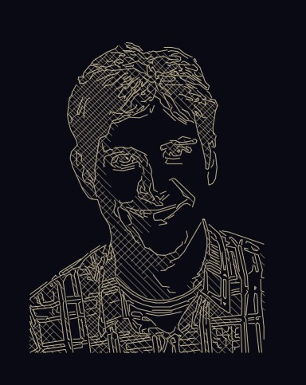

# Animator: Photo to Line Art

Upload a photo, and watch it draw itself as line art.

Animator turns any image into an engraving-style line drawing: outlines for
shape, and hatched strokes for shade. The result isn't a static picture. It's
a program, which Animator runs and animates stroke by stroke.

**Try it: https://alexdude1015.github.io/animator/**

| Photo | Line art drawn by Animator |
| :---: | :---: |
|  |  |

Image link: https://drive.google.com/file/d/1l4MDfMkdd9-VbuPTwvm1-wVRvjIMXqEP/view?usp=sharing

## How to use it

1. Open the app and click **Upload image** above the code editor.
2. Choose a photo. A preview of the line art appears right away.
3. Adjust the two sliders while watching the preview:
   - **Detail** sets how much of the outline is kept. Lower gives fewer, cleaner
     strokes; higher follows the photo more closely.
   - **Shading** sets how much of the image is hatched. 0 gives outlines only;
     higher fills more of the darker areas.
4. Name the drawing and click **Create**. The picture draws itself on the canvas.

Use the **Speed** slider to play the drawing faster, slower, or backward. The
drawing is saved in your browser with your others, so it's there next time.

Photos with a clear subject and a plain background work best, such as portraits,
pets, and logos. Busy backgrounds give a scribblier result.

## How it works

Outlines alone lose what makes a face recognizable: the dark areas, such as eyes,
brows, hair, and shadows. So Animator draws both outlines and shading.

1. **Prepare.** The photo is scaled to 500 pixels on its longest side, turned
   to grayscale, and its contrast is stretched so dim photos still have clear
   darks.
2. **Find outlines.** A Sobel filter finds where brightness changes sharply.
   Edges are thinned to one pixel and kept with a two-level threshold
   (hysteresis, as in the Canny edge detector): strong edges always count, and
   weaker ones count where they continue a strong one, so outlines stay
   connected without picking up noise.
3. **Trace strokes.** Neighbouring edge pixels are joined into chains, smoothed
   so they flow, and simplified with the Ramer-Douglas-Peucker algorithm, so a
   long straight run becomes a single line.
4. **Shade.** Darker areas are filled with hatching in three layers, like an
   engraving: mid-tones get sparse diagonal strokes, darker areas get a second
   set crossing them, and the darkest get extra strokes in between. Hatching is
   drawn thinner than outlines, so shape and shade stay distinct.
5. **Write the program.** Every stroke becomes a line in an ordinary `draw`
   function, with start times spread out so the strokes appear in turn:

   ```gleam
   // Line art traced from an image: 1358 lines.
   fn draw(shape_slider: Int) -> List(Path) {
     list.flatten([
       [
         Path(Line(Point(-193, -283), Point(-201, -272)), 0, 1, 2),
         Path(Line(Point(-201, -272), Point(-201, -266)), 0, 1, 2),
         ...
   ```

   Because the result is code, it can be edited by hand afterwards, for
   example to change a stroke's thickness or timing.

To keep the editor responsive, a drawing is capped at about 2,500 lines.

## The rest of Animator

The line-art importer is built on top of Animator, an app for drawings made by
programs. You write a `draw` function in a small Gleam-like language that
returns a list of lines, and the app animates them:

- a live code editor that reruns your code on every edit
- a **Shape** slider whose value is passed to `draw`, so a program can change its
  own shape
- a **Speed** slider, from -2x to 2x
- a library of drawings saved in your browser, starting with four examples (a
  fan, a square spiral, string art, and a tree)

The **Built-ins** panel under the editor lists everything the language supports.

## Running it

**Online:** nothing to install. Open https://alexdude1015.github.io/animator/
in a modern browser.

**On your own computer:** this repository holds the built app (`index.html`,
`animator.css`, and `app.mjs`). Browsers only load it from a web server, not by
opening `index.html` as a file, so serve the folder with any static server:

```sh
git clone https://github.com/AlexDude1015/animator.git
cd animator
python -m http.server 8000     # or: npx serve
```

Then open http://localhost:8000. The code editor loads from a CDN, so you need
an internet connection either way.

## About

Built in [Gleam](https://gleam.run) with [Lustre](https://lustre.build) for
UC Berkeley's CS 61A Animator project, where the photo-to-line-art importer is
my extension. This repository contains only the compiled, published app.
